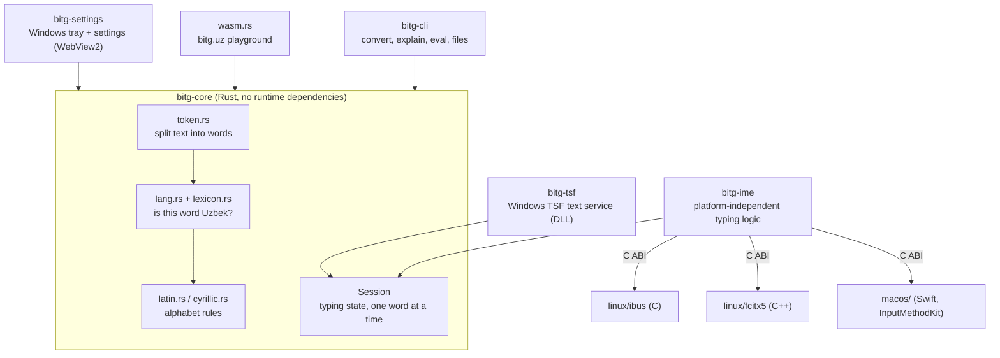
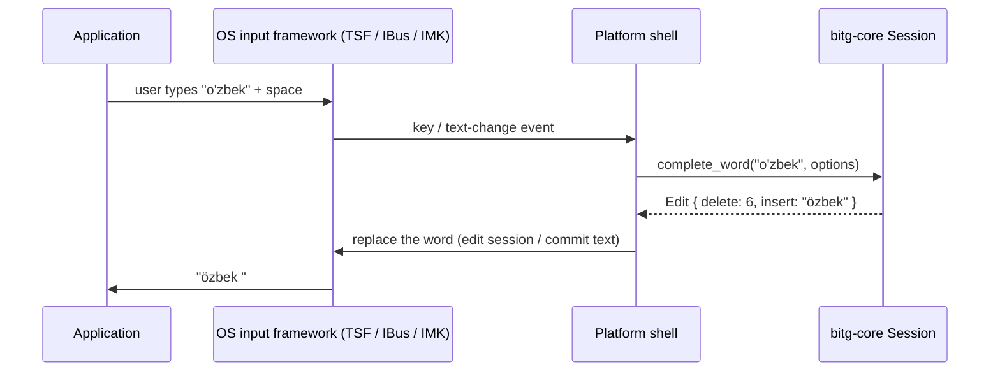

# Architecture

bitg converts Uzbek text to the 2026 Latin alphabet (`o'` → `ö`, `g'` → `ğ`, `sh` → `ş`, `ch` → `ç`, and every
apostrophe form of the glottal stop → `ʼ` U+02BC; `ng` stays two letters) while the user types, and leaves English and
foreign names alone. One Rust core does the conversion; thin platform layers connect
it to each operating system's input-method framework.

## Components

| Path | Role |
|---|---|
| `crates/bitg-core` | Conversion: tokenizer, language evidence (Uzbek lexicon from corpora, SCOWL English list, brand names, foreign names), alphabet rules, reverse and Cyrillic conversion, `Session` for typing, C ABI (`ffi.rs`) and WebAssembly ABI (`wasm.rs`). The lexicons are compiled into the binary by `build.rs`; nothing is loaded at runtime. |
| `crates/bitg-ime` | Typing logic shared by Linux and macOS: word boundaries, replace-in-place when the application exposes surrounding text, preedit when it does not, Backspace undo and learned exceptions, `settings.ini` / `exceptions.txt`. Exposed as a C ABI. |
| `crates/bitg-tsf` | Windows Text Services Framework text input processor. It watches text changes (`ITfTextEditSink`) and replaces the finished word through a TSF edit session. For applications that do not expose text (Qt, e.g. Telegram) it rebuilds the word from key events and sends Backspace + the new word with `SendInput`. |
| `crates/bitg-settings` | Windows tray icon and settings window; also the "convert selected text" hotkey (`Ctrl+Shift+Y`). |
| `crates/bitg-cli` | Command-line tool and the accuracy harness (`bitg eval eval/uz.tsv`). |
| `linux/`, `macos/` | Thin platform shells over `bitg-ime`, packaging (`.deb`, `.pkg`) and end-to-end tests. |
| `installer/` | WiX MSI for Windows. |
| `web/`, `tools/site/` | The bitg.uz static site and its build; the playground runs the real core compiled to WebAssembly. |
| `bot/` | `bitg-bot`: the `@bitguzbot` Telegram bot (converts messages with `bitg-core`, `/fikr` feedback to admins) and its small HTTP server behind Caddy (`web.rs`): `POST /api/feedback` for the apps' feedback window and `POST /mcp` (`mcp.rs`), the public MCP endpoint with the `convert_text` tool. |
| `extension/` | Browser extension (Manifest V3, Chrome/Edge/Firefox): converts selected text, an edit field, the visible page or (opt-in per site) words while typing, offline, with the core compiled to WebAssembly, the same file and ABI as the bitg.uz converter. |
| `integrations/` | Packages for AI assistants that use the MCP endpoint: Claude Code plugin and skill, ChatGPT directory plugin. |
| `packaging/` | Package manifests and recipes: winget, Chocolatey, Homebrew, AUR `PKGBUILD`, RPM spec (Fedora/openSUSE), Nix. |
| `deploy/` | bitg.uz server: Caddy configuration, Docker Compose, deploy scripts, the apt repository's public signing key, site statistics. |
| `fuzz/` | libFuzzer targets for the core (`convert`, `session`). |
| `eval/` | Accuracy sets: 3 000 Uzbek and 3 000 English sentences with expected output. |

## Data flow while typing

`Session::complete_word` returns an `Edit` that only touches the word just finished: `delete` is never larger than
the word (checked by the `session` fuzz target). Backspace right after a replacement restores the original and
remembers it as an exception.

## Trust boundaries

- **Input:** the only input is text the user types (and, for files, documents the user opens with the CLI). It is
  untrusted and arbitrary; the core handles any UTF-8 and never panics across an FFI or COM boundary (panics are
  caught at those boundaries and logged).
- **Network:** the input methods and the core never open network connections. Only the Windows settings app goes
  online: it checks `https://bitg.uz/update/stable.json` (WinHTTP, can be turned off) and sends feedback when the
  user asks it to. The site pages are static; `/mcp` and `/api/feedback` are served by the bot (`bot/src/web.rs`)
  with request limits.
- **Privileged surface:** the Windows text service is a DLL loaded into every application where the user types.
  It runs with the application's own rights; it is disabled in password, PIN and e-mail fields and in terminals.
  It uses no global keyboard hook.
- **Local files:** `settings.ini` and `exceptions.txt` in the user's profile; logs only record events and error
  codes, never typed text.

More detail on threats and how they are handled: [docs/ASSURANCE.md](docs/ASSURANCE.md).

## Build and release

`cargo build --workspace` builds everything; platform packages are built by `installer/build.ps1`,
`linux/build-deb.sh` and `macos/build.sh`. Releases are built only by GitHub Actions from a `v*` tag and carry
SHA-256 files, SLSA build provenance and an SBOM.
