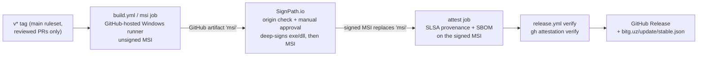

# Code signing policy

> **Status (2026-11-13): prepared, not yet active.** bitg has not yet applied to, or been accepted by, the SignPath
> Foundation. Until the [checklist](#application-checklist) below is complete, the Windows installer is **unsigned**
> and the CI signing step is skipped. This page is the policy that will apply from the first signed release, and it
> is the page SignPath reviewers are pointed to.

Free code signing provided by [SignPath.io](https://about.signpath.io), certificate by
[SignPath Foundation](https://signpath.org).

The same policy in Uzbek, for users: [bitg.uz/kod-imzosi](https://bitg.uz/kod-imzosi/).

## What is signed

Only Windows release files built from this repository by GitHub Actions are signed with the SignPath Foundation
certificate. One signing request per release covers the installer and every program file inside it:

| File | Where it is installed | Built by |
|---|---|---|
| `bitg-<version>-x64.msi` | Windows Installer package (the release asset) | `installer/build.ps1` (WiX 5) |
| `bitg-settings.exe` | `C:\Program Files\bitg\` — tray app and settings window | `crates/bitg-settings` |
| `bitg.exe` | `C:\Program Files\bitg\` — command-line tool | `crates/bitg-cli` |
| `bitg_tsf.dll` (x64) | `C:\Program Files\bitg\ime\<version>\` — the input method (TSF text service) | `crates/bitg-tsf` |
| `bitg_tsf.dll` (x86) | `C:\Program Files\bitg\ime\<version>\x86\` — the same input method for 32-bit apps | `crates/bitg-tsf` |

Not signed with this certificate: the Linux `.deb` packages (the apt repository has its own key, see
[SECURITY.md](../SECURITY.md)), the macOS `.pkg`, the Telegram bot, the website, and third-party code. The MSI contains
no third-party program files; the WiX custom-action DLL used during installation lives inside the MSI database and
is part of the WiX toolset, not of bitg.

Signed files carry product name `bitg` and the release version in their metadata; SignPath refuses to sign a file
whose metadata does not match ([`.signpath/artifact-configuration.xml`](../.signpath/artifact-configuration.xml)).

## How a release is signed



1. A maintainer pushes a `v*` tag. Only commits that reached `main` through a reviewed, squash-merged pull request can
   be tagged (`main` ruleset: no direct push, no force-push).
2. [`release.yml`](../.github/workflows/release.yml) calls the reusable [`build.yml`](../.github/workflows/build.yml).
   Its `msi` job builds the binaries and the MSI from source on a GitHub-hosted runner and uploads them as the
   workflow artifact `msi`.
3. The `sign-msi` job submits that artifact to SignPath with
   [`signpath/github-action-submit-signing-request`](https://github.com/signpath/github-action-submit-signing-request)
   (pinned by commit SHA). SignPath checks that the artifact was produced by a GitHub Actions run of
   `dtwinuz/bitg` on GitHub-hosted runners, and an **approver must approve the request by hand** in SignPath.
4. SignPath signs the four PE files inside the MSI, re-packs the MSI and signs the MSI (SHA-256 Authenticode with an
   RFC 3161 timestamp). The job checks every signature, recomputes the `.sha256` and replaces the `msi` artifact.
5. The `attest` job writes SLSA build provenance and the SBOM attestation for the **signed** MSI; `release.yml`
   verifies them before the GitHub Release is created.

Manual runs of `release.yml` (tests without a tag) use SignPath's `test-signing` policy with an untrusted test
certificate and never produce a release.

## Team roles

The roles follow [GOVERNANCE.md](../GOVERNANCE.md) and [CODEOWNERS](../.github/CODEOWNERS). All accounts below use
multi-factor authentication for GitHub (enforced by the `dtwinuz` organization) and for SignPath.

| SignPath role | Meaning | Members |
|---|---|---|
| Committers (authors) | may merge changes into `main` | maintainers [@XakimovNosirbek](https://github.com/XakimovNosirbek), [@leverow](https://github.com/leverow) |
| Reviewers | review every pull request from someone else before it is merged | maintainers above and reviewer [@wonmors](https://github.com/wonmors) ([core team](https://github.com/orgs/dtwinuz/teams/core) and CODEOWNERS) |
| Approvers | approve each signing request in SignPath | [@XakimovNosirbek](https://github.com/XakimovNosirbek), [@leverow](https://github.com/leverow) |

Every change, including build scripts and CI configuration (which SignPath counts as source code), is reviewed by
someone other than its author before it is merged ([GOVERNANCE.md, "Decisions"](../GOVERNANCE.md#decisions)).
Approvers check before approving that the request comes from a `v*` tag build of `dtwinuz/bitg` whose commit is on
`main`, and that the version matches the tag.

## Privacy policy

The input method (`bitg_tsf.dll`) and the command-line tool (`bitg.exe`) never connect to the network: conversion
runs locally and typed text is not stored or sent anywhere. The tray and settings app (`bitg-settings.exe`) makes
exactly these connections:

| When | What is sent | To | Can it be turned off? |
|---|---|---|---|
| **Update check**: 30 seconds after start, then once a day; or when the user picks "Check for updates" | an HTTPS `GET` of `https://bitg.uz/update/stable.json`; like any web request it reveals the IP address and the header `User-Agent: bitg/<version> (Windows)`. No text, no settings, no identifier | `bitg.uz` (bitg's own server) | Yes: Settings → Qoidalar → Ilova → "Yangilanishlarni tekshirish" (on by default) |
| **Installing an update**: only after the user clicks the update button | an HTTPS download of the MSI listed in the manifest (checked against its size and SHA-256) | `github.com/dtwinuz/bitg/releases` | the download happens only on request |
| **Feedback**: only when the user fills in the "Xabar berish" form and presses send | the text the user typed, optional contact and screenshot, app version, a random installation ID (only used to group reports), and — if the "Texnik ma'lumot qo'shish" switch is on, with a preview — Windows build and switch states. Never typed text from other apps | `https://bitg.uz/api/feedback` | nothing is sent unless the user sends the form |

Apart from this, in the words of the SignPath template: this program will not transfer any information to other
networked systems unless specifically requested by the user or the person installing or operating it.

The settings window uses Microsoft Edge WebView2 (part of Windows); its own data handling is covered by the
[Microsoft Privacy Statement](https://www.microsoft.com/privacy/privacystatement). The bitg.uz server logs and the
other parts of the project are described in the project privacy policy, [bitg.uz/maxfiylik](https://bitg.uz/maxfiylik/).

Source: [`net.rs`](../crates/bitg-settings/src/net.rs), [`updates.rs`](../crates/bitg-settings/src/updates.rs),
[`feedback.rs`](../crates/bitg-settings/src/feedback.rs), the update loop in
[`main.rs`](../crates/bitg-settings/src/main.rs).

## Verifying a signed file

Signed releases show **SignPath Foundation** as the publisher. The certificate belongs to the SignPath Foundation, not
to dtwinuz: this is how the program works ([signpath.org/terms](https://signpath.org/terms)).

```powershell
# PowerShell: Status must be Valid, the signer SignPath Foundation, with a timestamp
Get-AuthenticodeSignature .\bitg-0.5.0-x64.msi | Format-List Status, StatusMessage, SignerCertificate, TimeStamperCertificate

# Windows SDK signtool: /pa = default Authenticode policy, /all = every signature, /v = show the chain
signtool verify /pa /all /v .\bitg-0.5.0-x64.msi

# The installed files
Get-ChildItem 'C:\Program Files\bitg' -Recurse -Include *.exe, *.dll | Get-AuthenticodeSignature | Format-Table Status, Path
```

In Explorer: right-click the file → Properties → Digital Signatures.

### Relationship with GitHub artifact attestations

The Authenticode signature and the [GitHub artifact attestations](../SECURITY.md) answer different questions and
are checked independently:

- **Authenticode** (SignPath): Windows and SmartScreen trust the file; tampering after signing breaks the signature.
- **Attestation** (Sigstore, since v0.3.1): proves that this exact file came from the `build.yml` workflow of
  `dtwinuz/bitg` for a given tag, on GitHub-hosted runners, and links it to the SBOM.

Because signing happens inside the `build.yml` run, before the `attest` job, the attestation subject is the signed
MSI. The verification command stays the same:

```sh
gh attestation verify bitg-0.5.0-x64.msi -R dtwinuz/bitg \
  --signer-workflow dtwinuz/bitg/.github/workflows/build.yml --source-ref refs/tags/v0.5.0 --deny-self-hosted-runners
```

**Reproducible builds.** The unsigned MSI is reproducible byte for byte ([ASSURANCE.md](ASSURANCE.md)). Signing adds
signatures and timestamps, and deep signing re-packs the MSI, so the signed MSI cannot be rebuilt bit for bit by a
third party. To compare, build the same tag with `installer/build.ps1` and compare each installed file after removing
the signature (`signtool remove /s <file>`), or compare the attested unsigned build from a test run.

## Microsoft Store

bitg can be listed in the Microsoft Store as a Win32 app using the MSI download URL (policy
[10.2.9](https://learn.microsoft.com/windows/apps/publish/store-policies)), once the MSI is signed:

- **Signing:** "The binary and all of its Portable Executable (PE) files must be digitally signed with a code
  signing certificate that chains up to a certificate issued by a Certificate Authority (CA) that is part of the
  Microsoft Trusted Root Program." Deep signing covers the MSI and all four PE files. The Store does not re-sign
  MSI/EXE installers ([code signing options](https://learn.microsoft.com/windows/apps/package-and-deploy/code-signing-options)),
  and that page names the SignPath Foundation as the free option for open-source projects.
- **Publisher name:** neither the [MSI/EXE package requirements](https://learn.microsoft.com/windows/apps/publish/publish-your-app/msi/app-package-requirements)
  nor policy 10.2.9 require the certificate subject to match the Partner Center publisher name; the matching rule
  exists only for MSIX/AppX (`Identity Publisher` must equal the certificate subject). A listing published by
  "dtwinuz" whose installer is signed by "SignPath Foundation" is therefore allowed by the written rules. To avoid
  questions, explain it in "Notes for certification": *"The installer is signed by the SignPath Foundation under its
  free code signing program for open-source projects (https://signpath.org); policy: https://bitg.uz/kod-imzosi/."*
- **Account type:** policy 10.14: "Company accounts must be used for organizations, businesses, and any person
  acting in relation to their trade or profession." "dtwinuz" is an organization, so a company account (with
  business verification) is expected; an individual account under a maintainer's own name is the alternative.
- **Package URL:** a versioned HTTPS URL whose file never changes:
  `https://github.com/dtwinuz/bitg/releases/download/v<version>/bitg-<version>-x64.msi`. Every new release needs a
  new submission with the new URL.
- **Silent install:** the installer must not show UI when started by the Store. Installer parameters for Partner
  Center: `/qn /norestart` (the MSI supports this; `AUTOSTART`/`ADDKEYBOARD` keep their defaults).
- **Privacy policy URL** (policy 10.5.1, mandatory for Win32 apps): `https://bitg.uz/maxfiylik/` — it must describe
  the update check and the feedback form first (see open items).
- **Updates:** the "install and update only through the Store" rule (10.2.5) covers games and Xbox products and
  explicitly not 10.2.9 products, so the in-app update check may stay. It installs only a release MSI from
  `github.com/dtwinuz/bitg` checked against size and SHA-256, which is consistent with 10.2.2 (no dynamic code that
  changes the described functionality).

Steps: register at [storedeveloper.microsoft.com](https://storedeveloper.microsoft.com) → Partner Center → Apps and
games → New product → **MSI or EXE app** → reserve the name "bitg" → Packages: add the package URL, architecture x64,
installer parameters `/qn /norestart`, language uz/en → Store listing (Uzbek and English description, screenshots of
the settings window) → Properties: category Utilities & tools, privacy policy URL → Age ratings → Submit. Certification
can take up to three business days.

## Application checklist

Requirements from [signpath.org/terms](https://signpath.org/terms) and the SignPath
[GitHub integration](https://docs.signpath.io/trusted-build-systems/github) docs, with the current status:

| # | Requirement | Status |
|---|---|---|
| 1 | OSI-approved license for all components, no commercial dual-licensing | done — MIT OR Apache-2.0, `cargo deny check licenses` in CI |
| 2 | No proprietary components (system libraries allowed) | done — Windows system DLLs and WebView2 only |
| 3 | No malware / PUP, no hacking tools | done |
| 4 | Actively maintained, already released in the form to be signed | done — MSI releases since v0.1.0 (2026-11-12) |
| 5 | Functionality described on the download page | done — [bitg.uz/yuklab-olish](https://bitg.uz/yuklab-olish/) |
| 6 | Verifiable reputation for executables ("we cannot sign binaries based on source code that nobody knows") | **open** — the repository is new (created 2026-11-11); collect download statistics, press and community links before applying |
| 7 | "Code signing policy" on the home page and the download/release pages | partly — this file, README section, [bitg.uz/kod-imzosi](https://bitg.uz/kod-imzosi/), release notes (added automatically once SignPath is configured); **open:** link from the bitg.uz home page and `/yuklab-olish/` |
| 8 | Team roles listed; MFA for GitHub and SignPath | done for GitHub; SignPath accounts: after acceptance |
| 9 | Privacy: data sent to systems not chosen by the user needs a privacy policy, shown during installation, with an installation option to disable it | **open** — the update check is described above and can be switched off in the app; still missing: an MSI property to disable it at install time, a privacy link in the installer UI, and an updated bitg.uz/maxfiylik |
| 10 | Builds on GitHub-hosted runners from the public repository, verifiable from source | done — `build.yml`, SLSA Build L3 |
| 11 | Metadata restrictions: product name `bitg`, same product version for every signed file | **open** — the exe/dll files have no `VERSIONINFO` resource yet; add one (ProductName `bitg`, ProductVersion = Cargo version) to `bitg-settings`, `bitg-cli` and `bitg-tsf` before the first signing |
| 12 | Manual approval of every release signing request | done — `release-signing` policy with approvers |
| 13 | CI integration | done — `sign-msi` job, inactive until `SIGNPATH_ORGANIZATION_ID` is set |

### After acceptance (maintainer, once)

1. In SignPath: enable MFA; add the predefined trusted build system **GitHub.com** to the organization and link it to
   the project; install the SignPath GitHub App for `dtwinuz/bitg`.
2. Project `bitg` → default artifact configuration → paste [`.signpath/artifact-configuration.xml`](../.signpath/artifact-configuration.xml);
   use "Update from an artifact sample" with a test-run MSI once to confirm the paths inside the MSI.
3. Signing policies `release-signing` (approvers above) and `test-signing`; create a CI user with the *submitter*
   role on both and an API token.
4. GitHub → `dtwinuz/bitg` → Settings → Secrets and variables → Actions: secret `SIGNPATH_API_TOKEN`, variable
   `SIGNPATH_ORGANIZATION_ID`, optional variable `SIGNPATH_PROJECT_SLUG` (default `bitg`). If the old PFX secrets
   `BITG_SIGN_PFX*` exist, remove them: SignPath replaces any earlier signature.
5. Run `release.yml` by hand (test-signing), then tag the next release and approve the request in SignPath.
6. Update [SECURITY.md](../SECURITY.md) ("Imzo haqida") and the README install note, which still say the MSI is
   unsigned.
